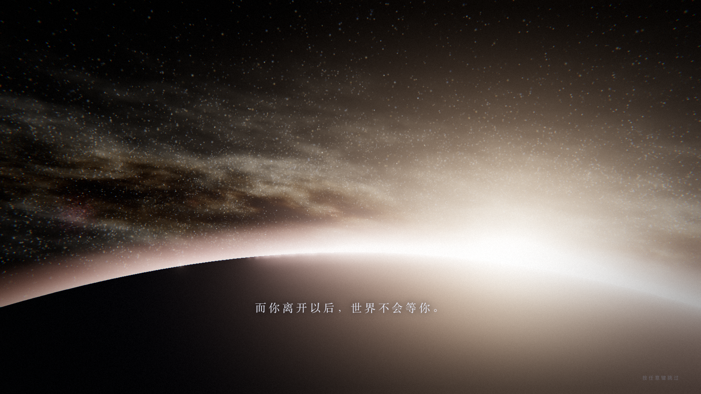
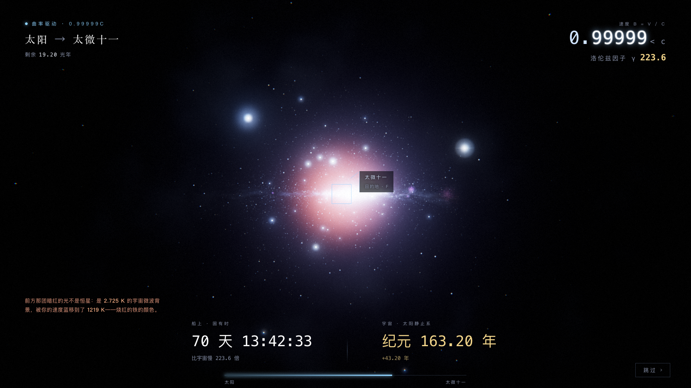
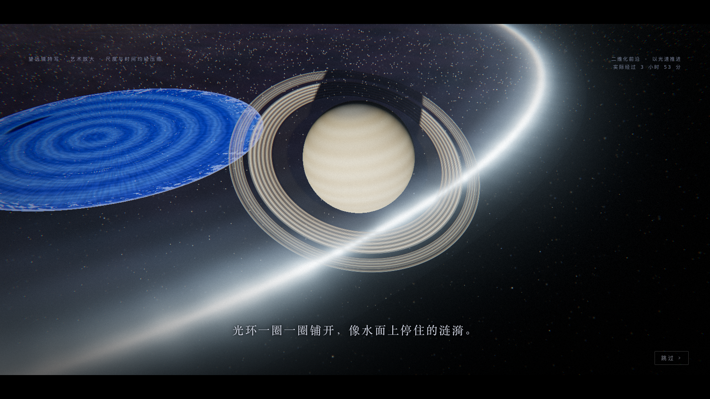
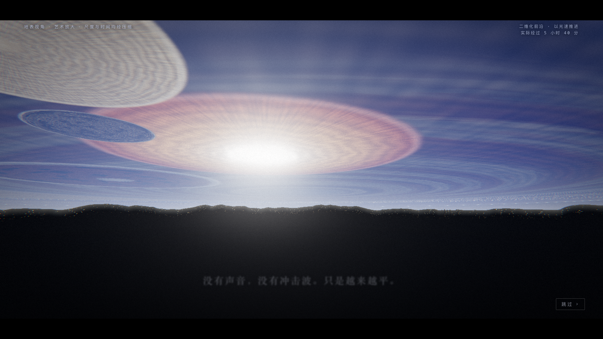
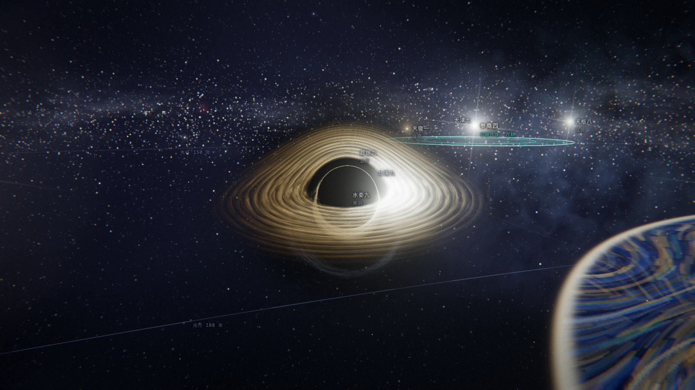
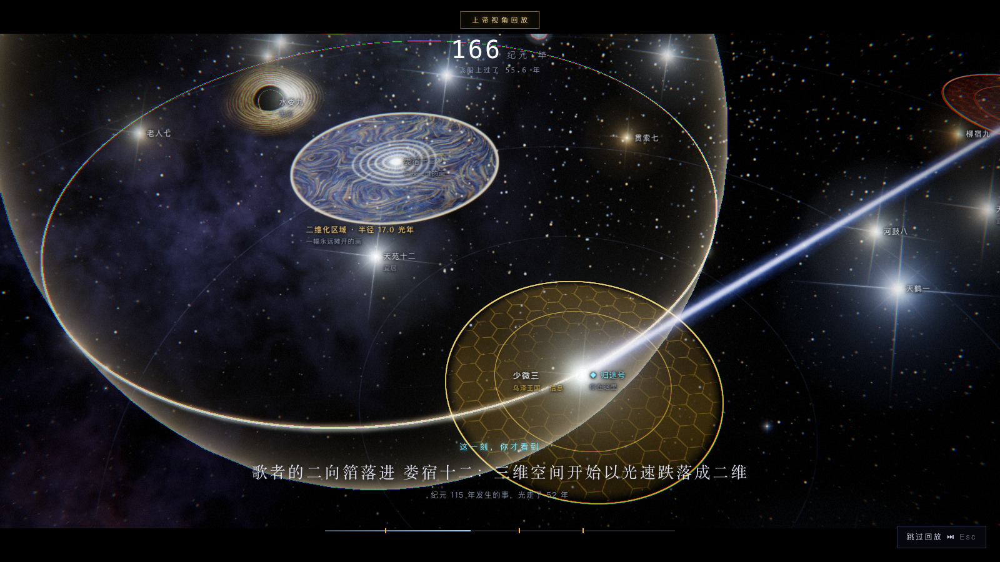
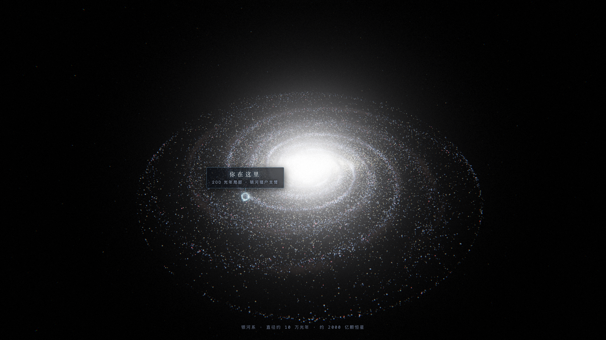
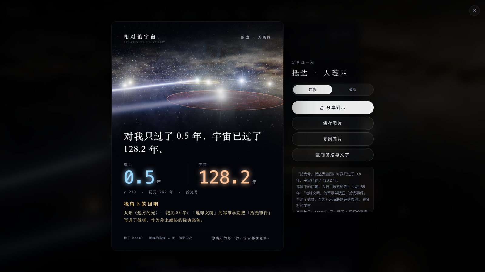

# 相对论宇宙 · Relativity Universe

> **你离开的每一秒，宇宙都在老去。**

一个遵守真实相对论（光速上限、洛伦兹时间膨胀、光行差与多普勒频移、光延迟）与《三体》宇宙法则（黑暗森林、歌者清理、光粒、二向箔降维、黑域）的 3D 网页宇宙沙盒。

**在线试玩（GitHub Pages）：** <https://windameister.github.io/relativity-universe/>

### 直达视觉奇观

- 🌌 **完整体验（开场 → 星图 → 航行）**：<https://windameister.github.io/relativity-universe/>
- 🛸 **第一视角 0.99999c 曲率航行**（光行差 + 多普勒 + 宇宙微波背景蓝移）：<https://windameister.github.io/relativity-universe/game/?scene=warp>
- 📄 **二向箔吞没太阳系**（地球视角终局）：<https://windameister.github.io/relativity-universe/game/?scene=foil>
- 🕳️ **星系全息图 & 史瓦西黑洞 & 10 万光年银河拉远**：<https://windameister.github.io/relativity-universe/game/?scene=galaxy>

---

## 画面一览

| 地球日出与银河开场 | 0.99999c 曲率巡航（1219K 宇宙微波背景蓝移） |
|---|---|
|  |  |

| 二向箔吞没土星（光环铺开成同心条纹） | 地球地表仰望：二维平面横跨整个天空 |
|---|---|
|  |  |

| 史瓦西黑洞双引力拱弧 | 上帝视角回放：光球扫到飞船「这一刻，你才看到」 |
|---|---|
|  |  |

| 滚轮拉远至 10 万光年银河系 | 一键生成分享海报与复现链接 |
|---|---|
|  |  |

---

## 物理硬规则

1. **没有东西能超光速**：任何航行、武器、信号，外部时间永远满足 $t_{\mathrm{ext}} \ge d / c$。
2. **曲率驱动不超光速**：遵循《三体》设定，曲率驱动只是将飞船瞬间推到无限接近 $c$（0.999c / 0.9999c / 0.99999c），船上固有时由真实洛伦兹因子 $\gamma = 1 / \sqrt{1-\beta^2}$ 压缩；代价是在出发地与目的地留下长久可见的曲率航迹，暴露坐标。
3. **常规推进接近不了光速**：上限 0.03c，$\gamma \approx 1$，一趟动辄数千年，舰员必须全程冬眠。
4. **光延迟是世界规则**：距离 $d$ 光年的恒星，你默认只能看到 $d$ 年前的样子。等你飞过去，或许早已物是人非。
5. **黑暗森林与由历史驱动的 101 个事件**：你的礼物、技术、星图、假扮神明或广播坐标，都会在几百年后长出可追溯的回响——盟友变成屠夫、母星成为猎手、流亡舰队认出你的飞船、以你之名的宗教改革或圣战，或者歌者顺着你的曲率航迹随手扔来一片二向箔。

---

## 本地运行与构建

不需要安装任何前端依赖，纯静态 HTML + Three.js + WebGL GLSL + WebAudio 程序化音频。

```bash
# 本地静态服务
python3 -m http.server 8765
# 打开 http://127.0.0.1:8765/game/
```

也可以直接双击打开单文件打包版 `game/dist/relativity-universe.html`。

### 仓库结构

- `game/` — 3D 正式版客户端（Three.js r187 + 自定义 GLSL 着色器 + WebAudio 程序化音效）
  - `game/build.py` — 从 `prototype/index.html` 抽取模拟内核生成 `game/gen/sim.js`，并打包单文件版 `game/dist/relativity-universe.html`
- `prototype/` — 模拟内核（确定性数学 + 惰性求值 + 光延迟 + 101 事件库）与 2D/3D 原型
- `docs/` — [需求与硬规则](docs/01-REQUIREMENTS.md)、[迭代历史](docs/02-ITERATION-HISTORY.md)、[路线图](docs/03-ROADMAP.md)、[架构文档](docs/ARCHITECTURE.md)、[事件库设计](docs/EVENT_LIBRARY_DESIGN.md)
- `playtest/` — 试玩报告与统计脚本
- `assets/showcase/` — 高清展示截图

### 回归测试

```bash
cd prototype
node tools/evcheck.js --static   # 101 个事件静态可达性检查
node test_sim.js                 # 物理硬规则、不超光速、确定性与 150 局冒烟测试
```
